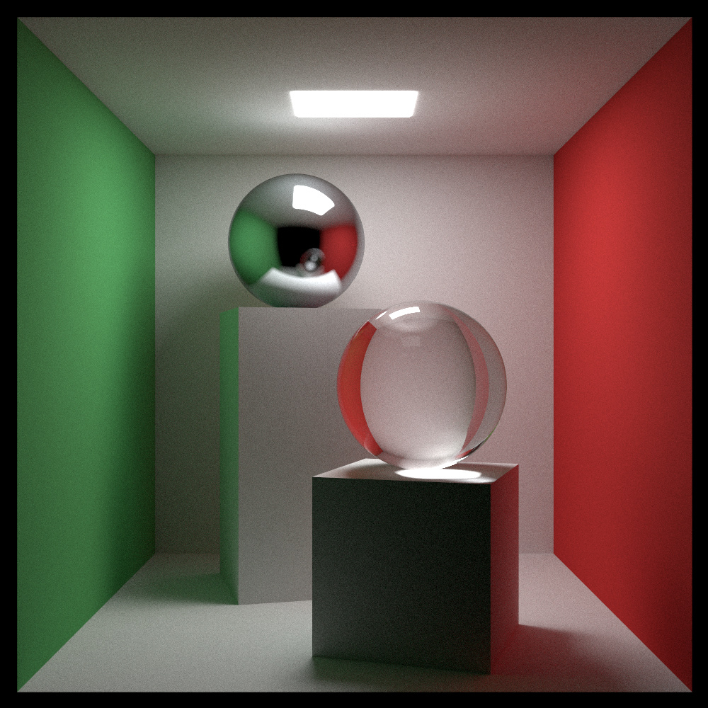
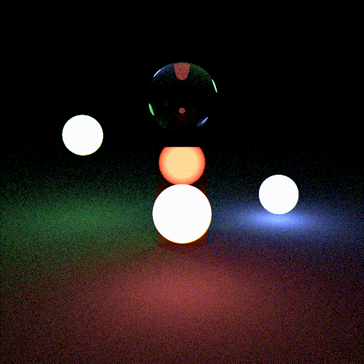
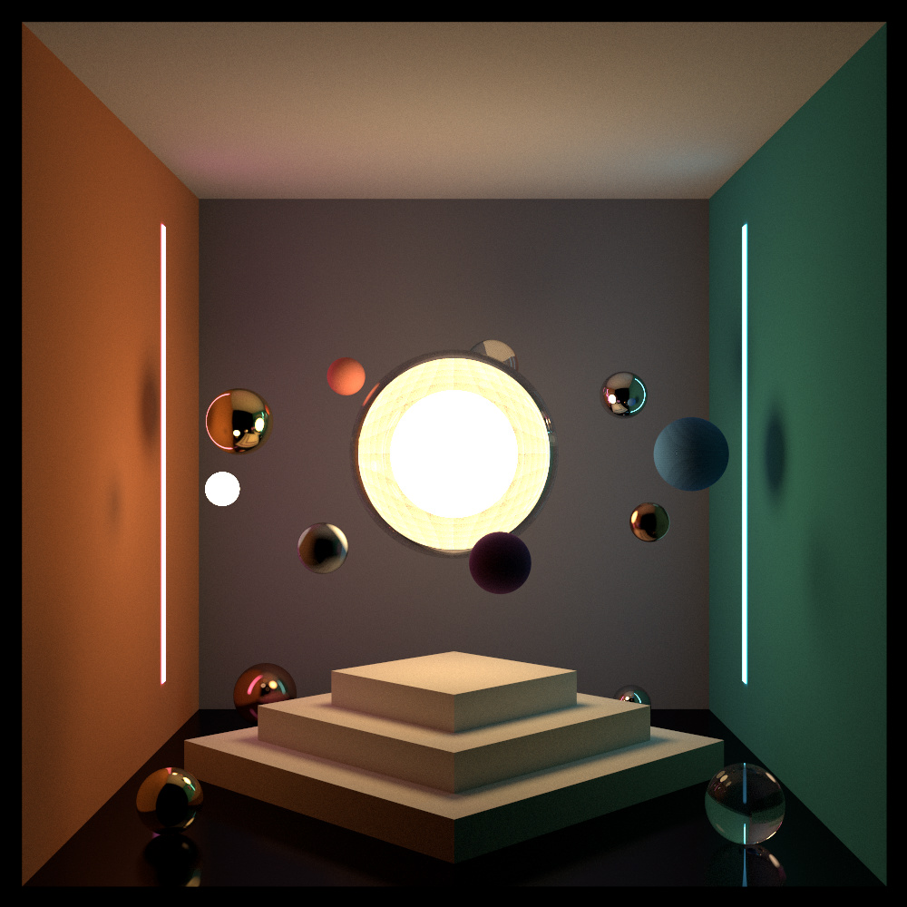

# 4ZT

  

> `showcase/cornellbox_1.jpg` rendered with 4ZT v0.5.0 at 10000 spp

## Overview
4ZT is a physically based offline path tracer rendering engine. Its abstract rendering class allows for computation with multithreading CPU and GPU acceleration.

The engine is designed as a static API and is intended to be used as a library for rendering applications. As showcased by the demo `standalone` application as well as the `scout` real time renderer.

### Features
- Image (JPEG, PNG, PPM, HDR and EXR) and Video (MP4, MKV, GIF) outputs
- Multithreaded CPU and GPU compute renderers
- Full PBR materials (Metal, Dielectric, Lambertian)
- BVH acceleration structure
- HDR output

## Project Structure
This repository contains the following projects:
- `raytracer`: The core rendering engine library
- `standalone`: A simple headless demo application that renders the demo scene right away
- `scout`: A real time renderer that allows for scene manipulation and rendering

## Comparison
Side by side with Blender Cycles (Blender 5.2.3 LTS)

Blender project file: `showcase/comparison/blender_scene.blend`

  4ZT             |  Blender Cycles
:-------------------------:|:-------------------------:
 07.857s |  61.502s

> [!WARNING]  
> This might not be a fair comparison! Although it was as similar as possible

### Comparison Settings
- Render Device: **GPU** (RX 7900 XT)
- Resolution: **1000x1000**, FOV: **40°**
- Samples per Pixel: **10000**
- Max Depth: **50**
- Denoising: **OFF**

## Showcase

> Video demo (v0.5.0) and a rendered image of the Cornell Box scene (v 0.4.0).

## Scout Editor
This project is a work in progress. The Scout Editor is a real time renderer based on Vulkan 1.4 that allows for scene manipulation and rendering. It is built on top of the 4ZT engine and uses the same rendering pipeline.

It currently uses a simple dear imgui interface but I would like to implement something else like rmlui at some point. The editor is still in development and is not yet feature complete at all.

## License
This project is licensed under the MIT License. See `LICENSE` for more information.

## Acknowledgements
Resources that helped a lot
- [Ray Tracing in One Weekend Series](https://raytracing.github.io/)
- [Physically Based Rendering:From Theory To Implementation](https://pbr-book.org/)