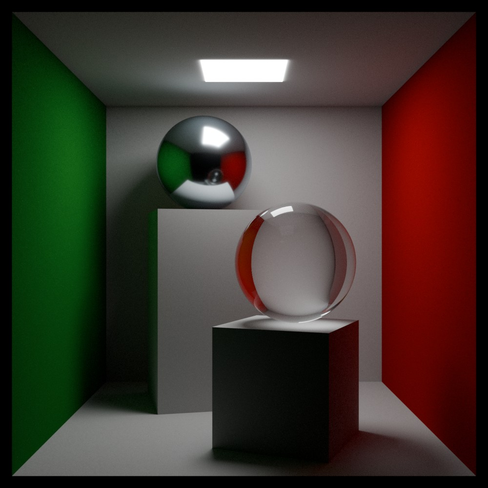
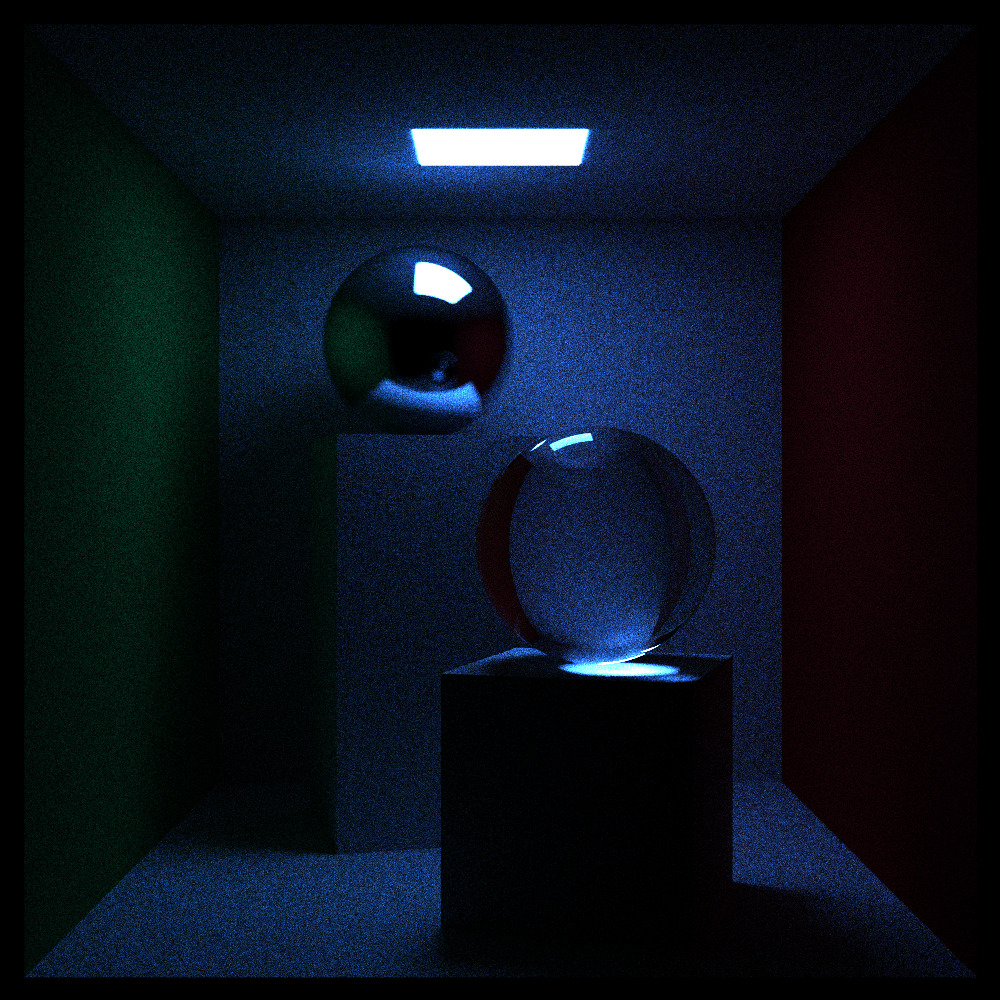
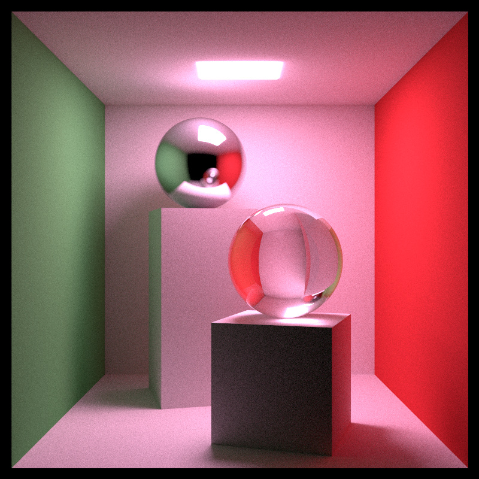

# 4ZT

  

## Overview
4ZT is a physically based offline path tracer rendering engine. It is designed to be a simple and easy to use library for rendering applications. The project also includes a realtime editor that allows you to setup a scene in a more interactive way rather than writing the scene in code

The engine's renderer is an abstract class that has a multithreaded CPU implemenation and also a GPU (Vulkan) implementation

The engine is still in development and is missing some features, like a proper denoiser, but it is already capable of rendering complex scenes with a good performance. Contributions are welcome

### Features
- Image (JPEG, PNG, PPM, HDR and EXR) and Video (MP4, MKV, GIF) outputs
- Multithreaded CPU and GPU compute renderers
- Full PBR materials (Metal, Dielectric, Lambertian)
- BVH acceleration structure
- HDR output

## Project Structure
This repository contains the following projects:
- `raytracer`: The core rendering engine library
- `standalone`: A simple headless demo application that renders the demo scene right away
- `scout`: A real time renderer that allows for scene manipulation and rendering

Compiling requires Cmake 4.0 and a C++20 compatible compiler, as well as the slang shader compiler. The rest of the dependencies are included with cmake's FetchContent modules. All features are tested on Fedora 45

## Comparison
Side by side with Blender Cycles (Blender 5.2.3 LTS)

Blender project file: `showcase/comparison/blender_scene.blend`

  4ZT             |  Blender Cycles
:-------------------------:|:-------------------------:
 07.857s |  61.502s

> [!WARNING]  
> This might not be a fair comparison! Although it was as similar as possible

#### Comparison Settings
- Render Device: **GPU** (RX 7900 XT)
- Resolution: **1000x1000**, FOV: **40°**
- Samples per Pixel: **10000**
- Max Depth: **50**
- Denoising: **OFF**

## Showcase
All these files might be rendered with different settings and old versions of the engine

<table>
  <tr>
    <td></td>
    <td></td>
  </tr>
  <tr>
    <td></td>
    <td></td>
  </tr>
</table>

## Scout Editor
This is a side-project that is a work in progress. The Scout Editor is a real time renderer based on Vulkan 1.3 that allows for scene manipulation and rendering. It is built as a "client" of the 4ZT engine and allows to setup a scene for rendering in a more user-friendly way. The editor is still in development and is not yet feature complete at all. It currently uses a simple dear imgui interface but I would like to implement something else like rmlui at some point

## License
This project is licensed under the MIT License. See `LICENSE` for more information.

## Acknowledgements
Resources that helped a lot
- [Ray Tracing in One Weekend Series](https://raytracing.github.io/)
- [Physically Based Rendering:From Theory To Implementation](https://pbr-book.org/)